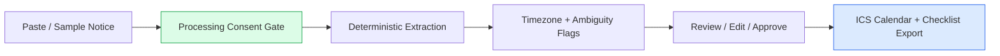
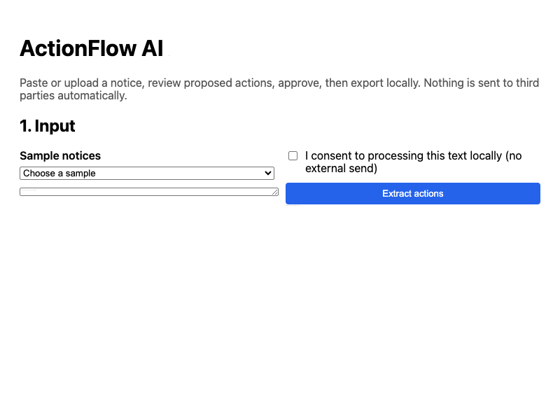
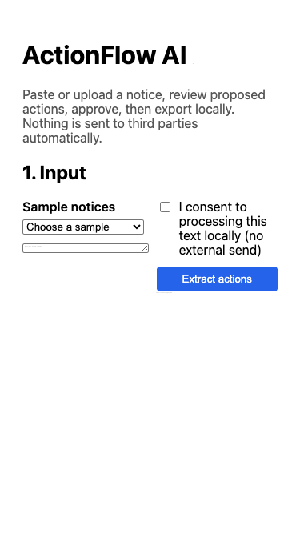

# ActionFlow AI

Everyday information into approved actions (MVP).

## Live Demo

🌐 **[Open the interactive demo →](https://bamaboy101.github.io/actionflow-ai/)**

No setup, no credentials, no backend required. Runs entirely in your browser with labeled synthetic data.

---

## What It Delivers

Someone can paste an invitation or use a sample document, review proposed actions and export a calendar reminder without connecting a private mailbox.

**Paste → Extract → Review → Approve → Export.**

- Paste-text and synthetic sample notices — no mailbox access, no private data upload
- Deterministic extraction of dates, times, tasks, parties, and requirements
- Timezone and ambiguity flags — **no guessed timezones**
- Review/edit/approve/reject each suggested action
- Local ICS calendar export or task-checklist download
- Idempotent export; no export of unreviewed actions
- **No automatic sending, payments, or calendar creation without consent**

---

## Architecture



**Trust boundaries:** Manual intake first; no mailbox OAuth scopes. Raw text not persisted or printed in logs by default. No external actions without explicit user selection and confirmation. Unknown timezones require clarification — never guessed.

## Demo Preview

The live dashboard at **https://bamaboy101.github.io/actionflow-ai/** shows:

- Sample notice selector and paste input
- Consent checkbox
- Extracted actions with source spans and timezone flags
- Ambiguity warnings (missing timezone)
- Approve button and .ics / checklist download

## Demo Preview





## Features

| Feature | Status |
|---|---|
| Paste-text intake + synthetic samples | ✅ Verified |
| Deterministic extraction (dates/times/tasks/parties/requirements) | ✅ 5/5 tests pass |
| Timezone + ambiguity flags | ✅ Verified |
| Processing consent gate | ✅ Verified (400 without consent) |
| Review/edit/approve/reject | ✅ Verified |
| ICS calendar export | ✅ Verified |
| Task-checklist export | ✅ Verified |
| Idempotent export (approved actions only) | ✅ Verified |
| No auto-send / no mailbox OAuth | ✅ By design |

---

## Installation

```bash
# Clone
git clone https://github.com/bamaboy101/actionflow-ai.git
cd actionflow-ai

# Backend
cd apps/api
npm install          # dev deps include vitest
npm test             # 5 tests pass
npm run dev          # API on :4002

# Frontend (new terminal)
cd ../web
npm install
npm run dev          # Dashboard on :5175

# Docker (optional, once Docker daemon available)
cd ../.. && docker compose up --build
```

Copy `.env.example` to `.env`. Demo uses labeled demonstration responses (no external AI call).

---

## Configuration

| Variable | Purpose | Required |
|---|---|---|
| `PORT` | API port (default 4002) | No |
| `AI_PROVIDER` | `demo` (default), `nvidia`, `openrouter` | No |
| `NVIDIA_API_KEY` / `NVIDIA_MODEL` | Optional live AI provider | No |
| `OPENROUTER_API_KEY` / `OPENROUTER_MODEL` | Optional OpenRouter fallback | No |

No credentials are hardcoded, logged, or committed.

---

## AI Provider

Configurable adapter supports **NVIDIA** (preferred), **OpenRouter** (optional fallback), and **demo** (default). NVIDIA API is reachable and authenticated; no suitable model is available for this account, so the default is clearly labeled demonstration responses. OpenRouter is not required.

---

## Limitations

- Text-PDF upload / OCR not included (MVP)
- Opt-in calendar provider connection not included
- Email intake and multilingual parsing not included
- No automatic sending, payments, or calendar creation

---

## Security

- **Manual intake first; no mailbox OAuth scopes.**
- **Raw text not persisted or printed in logs by default.**
- **No external actions without explicit user selection and confirmation.**
- **Unknown timezones require clarification — never guessed.**
- See `docs/privacy.md` for details.

---

## Demo

🌐 **[ActionFlow Live Demo](https://bamaboy101.github.io/actionflow-ai/)** — browser-based, no setup, labeled synthetic data.

View source: `https://github.com/bamaboy101/actionflow-ai`

---

## License

[MIT](LICENSE)
